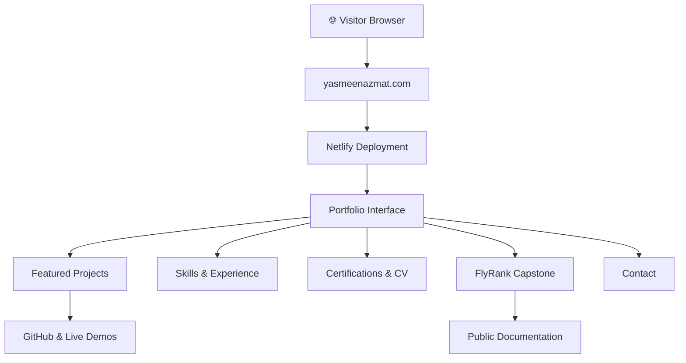

<div align="center">

<sub><strong>PROJECT DOCUMENTATION  /  GENERAL AI FLUENCY</strong></sub>

# ✦ From Projects to Proof

### AI/ML Engineering Portfolio · Technical Case Study

A public, evidence-first portfolio connecting technical projects, demonstrable results, engineering decisions, and transparent limitations.

[](https://yasmeenazmat.com/) &nbsp; [](https://internship.flyrank.ai/) &nbsp; [](https://internship.flyrank.ai/verify?id=FR-D11-46948-FE5B2&first_name=Yasmeen)

**Yasmeen Azmat Ali** · 2026

[**Overview**](README.md) &nbsp;·&nbsp; [**Final Evidence Index**](FINAL_SUBMISSION_INDEX.md) &nbsp;·&nbsp; [**Retrospective**](RETROSPECTIVE.md) &nbsp;·&nbsp; [**NEXA Roadmap**](NEXT_CASE_STUDY_PLAN.md) &nbsp;·&nbsp; [**NEXA Testing**](NEXA_TESTING_REPORT.md) &nbsp;·&nbsp; [**n8n Workflow Atlas**](NEXA_WORKFLOWS.md)

</div>

---

> **On this page:** [Project snapshot](#-project-snapshot) · [Engineering work](#-featured-engineering-work) · [Architecture](#️-system-architecture) · [Evaluation](#-performance--quality) · [Limitations](#️-known-limitations) · [Demo](#-live-demonstration)

---


## ✨ Project Snapshot

| | |
|---|---|
| **Project** | From Projects to Proof — AI/ML Engineering Portfolio |
| **Category** | AI/ML Engineering · Portfolio · Web Development |
| **Purpose** | Make engineering work discoverable, understandable, and verifiable |
| **Audience** | Recruiters · Engineers · Collaborators · Hiring Teams |
| **Tech Stack** | HTML · CSS · JavaScript · Netlify |
| **Deployment** | [yasmeenazmat.com](https://yasmeenazmat.com) |
| **Source Code** | Private implementation |
| **Documentation** | Public |
| **FlyRank Status** | AI Fluency qualified; impact project accepted October 5, 2026 |
| **Issued Credential** | [FlyRank AI Fluency verified record](https://internship.flyrank.ai/verify?id=FR-D11-46948-FE5B2&first_name=Yasmeen) · October 13, 2026 |

---

## 🎯 The Story Behind the Project

### The Challenge

AI/ML engineering work often lives across GitHub repositories, demonstrations, academic projects, and professional profiles.

For recruiters and technical reviewers, this makes it difficult to understand what was built, how it works, and what evidence supports it.

### The Solution

I built a single professional portfolio that brings together technical projects, practical demonstrations, skills, experience, certifications, and project documentation.

Rather than relying on technology lists alone, the portfolio emphasizes:

**Problem → What I Did → What Came of It**

### The Outcome

A deployed, responsive portfolio with a consistent project-card design, interactive navigation, animations, technical evidence links, and a dedicated FlyRank Capstone section.

The portfolio makes it easier to explore my engineering work and understand the decisions behind it.

---

## 🧠 Featured Engineering Work

| Project | Focus |
|---|---|
| **Multi-Agent RAG Research Assistant** | Retrieval, research automation, and agent orchestration |
| **InvoiceGuard** | Explainable invoice-risk assessment and human approval |
| **CivicRelay** | Agentic civic-issue management |
| **Clerkly** | Human-in-the-loop paperwork workflows |
| **Real-Time Twitter Sentiment Analysis** | Kafka, Spark, NLP, and streaming machine learning |
| **AI Career Guidance Assistant** | AI-powered career exploration and skills guidance |

**[Explore All Projects ↗](https://yasmeenazmat.com/#projects)**

*Live demonstrations and GitHub repositories are linked where available. Not every project currently has a public deployment.*

---

## ⚡ Portfolio Features

| Feature | Description |
|---|---|
| 🎨 **Responsive Design** | Desktop and mobile-friendly layouts |
| ✨ **Motion & Interaction** | Section reveals, hover effects, and animated elements |
| 🧩 **Featured Projects** | Consistent cards with project context and evidence |
| 🔎 **Project Exploration** | Navigation and available project filters |
| 🏆 **FlyRank Capstone** | Compact approved-project showcase |
| 📄 **Professional Profile** | Skills, experience, certifications, and CV |
| 🔗 **Evidence Links** | GitHub repositories and available demonstrations |
| ✉️ **Contact** | Professional contact options |

---

## 🏗️ System Architecture



### Technology Stack


The architecture illustrates the visitor-facing system. Internal contact processing and deployment configuration are not independently verified in this public documentation.

---

## 🚀 Explore the Portfolio

**No installation or account is required.**

1. Open **[yasmeenazmat.com](https://yasmeenazmat.com)**.
2. Browse the Featured Projects and additional projects.
3. Use the available filters and open supporting evidence links.
4. Review skills, experience, and certifications.
5. Explore the FlyRank Capstone section.
6. Download the CV or use the available contact options.

<details>
<summary><b>💻 Local Development and Reproducibility</b></summary>

The portfolio implementation is private.

Authorized collaborators with the original HTML, CSS, JavaScript, and assets can run the static version locally.

```bash
python3 -m http.server 8000
```

Then open:

```text
http://localhost:8000
```

Check navigation, images, project cards, animations, CV download, and contact behavior.

**Reproducibility limitation:** This public evidence repository does not contain the complete source. The source ZIP and detailed local preview instructions are available in the [separate private portfolio-source repository](https://github.com/yasmeenmh90-beep/ai-ml-portfolio-source); reviewers need a verified collaborator invitation, and a successful local reproduction is still awaiting confirmation.

</details>

---

## 📊 Performance & Quality

### October 11, 2026 — PageSpeed Insights

| Category | Recorded Result |
|---|---:|
| 🖥️ Desktop Performance | **98/100** |
| 📱 Mobile Performance | **71–72/100** |
| ♿ Accessibility | **100/100** |
| 🛡️ Best Practices | **100/100** |
| 🔍 SEO | **100/100** |
| 🤖 Agentic Browsing | **2/2** |

These results were measured before the latest Capstone redesign. They should not be interpreted as fresh scores for the final version.

**Mobile metrics:** FCP 4.1 s · LCP 4.7 s · TBT 0 ms · CLS 0 · Speed Index 5.1 s.

### Testing Summary

| Area | Recorded Status |
|---|---|
| Desktop layout | User-tested |
| Mobile responsiveness | User-tested |
| Scroll animations | Implemented and user-tested |
| Project-card hover effects | User-tested |
| Capstone redesign | Completed and visually reviewed |
| Navigation and project filters | User-tested; detailed results not recorded |
| Static package inspection | 4/4 categories passed on earlier package |
| Final-version PageSpeed | Retest pending |

<details>
<summary><b>🔬 Detailed Static Verification</b></summary>

**Evidence date:** October 11, 2026

| Check | Result |
|---|---|
| Local asset references | 15/15 resolved |
| Internal section anchors | 16 inspected, 0 unresolved |
| Image alternative text | 10/10 nonempty |
| Main portfolio sections | Present |
| Static inspection categories | 4/4 passed |

These results apply to the inspected earlier package.

</details>

<details>
<summary><b>🧪 Additional Verification Boundaries</b></summary>

The following checks still need documented end-to-end results:

- Individual external-link destinations
- CV download behavior
- Contact-form delivery
- Manual keyboard accessibility
- Final-version mobile and desktop PageSpeed measurements

User-reported functional testing and static checks are not substitutes for these specific tests.

</details>

---

## 🎨 Engineering & Design Decisions

### 01 — Evidence Over Claims

The portfolio prioritizes project context, engineering decisions, and links to supporting work rather than only displaying technology names.

### 02 — Consistency Across Projects

Featured Projects share a consistent card layout so visitors can compare projects without learning a different interface for each one.

### 03 — Compact FlyRank Capstone

The Capstone was redesigned to match the Featured Projects cards.

Unnecessary nested panels, oversized spacing, and separate Challenge/Solution/Outcome boxes were removed while preserving the screenshot, links, and approved status.

### 04 — Motion With Purpose

Subtle animation, hover lighting, and scroll-triggered reveals make the portfolio engaging without replacing meaningful technical content.

### 05 — Public Evidence, Private Implementation

Documentation is public for reviewers, while implementation source files remain private. This improves public discoverability but limits independent source-based reproducibility.

---

## ⚠️ Known Limitations

- The complete implementation is not publicly available.
- Some projects still need additional interactive demonstrations.
- Mobile performance has room for improvement based on the recorded October 11 test.
- Final-version PageSpeed and complete end-to-end verification remain pending.
- Building in Public can be expanded with deeper technical case studies.
- NEXA remains in development and is not presented as completed work.
- FlyRank AI Fluency verification is issued, and the badge is shown in the portfolio Certifications section. Footer placement should be checked separately against Week 7 assignment wording.

---

## 🤝 AI Assistance & Human Verification

I built and refined this portfolio with assistance from Claude AI, particularly for frontend development, interface design, and documentation. I selected the projects, reviewed the generated work, tested the website on desktop and mobile, and verified the recorded evaluation results. I remain responsible for the final implementation and published content.

---

## 🎬 Live Demonstration

**Format:** Narrated live walkthrough of the deployed site (no slides)
**Duration:** 3:07
**Status:** ✅ Recorded

| Time | What the demo shows |
|---|---|
| 0:00–0:40 | Portfolio introduction and purpose: hero section and the three main actions (View My Projects, Get in Touch, Book a Meeting) |
| 0:40–1:24 | Featured Projects and interactive filters (Agentic AI, Apps & Backend, All) — **design decision: evidence over claims** |
| 1:24–1:40 | Project evidence: InvoiceGuard live demo, its demo video on YouTube, and its GitHub repository |
| 1:40–1:56 | More projects, education, experience, skills, and the IBM RAG and Agentic AI certificate (verified on Coursera) |
| 1:56–2:24 | Live contact-form test: native validation, honeypot spam field, duplicate-submit guard, and the submission arriving in Netlify Forms |
| 2:24–2:40 | FlyRank Capstone section and this README: system architecture and next improvements |
| 2:40–2:52 | **Known limitation:** PageSpeed Insights (Oct 13, 2026): Desktop 98, Mobile 71 |
| 2:52–3:07 | AI assistance, what I verified myself, and close |

**Demo video:** [Watch the demo](https://www.youtube.com/watch?v=45gVlp1G5Wk)

---

> **Portal status update · October 14, 2026:** The General AI Fluency track shows **25/26** assignments, and **Documentation and Demo Video (FL-09)** is still marked **Not started**, despite existing documentation and the 3:07 portfolio video. The two previously submitted Week 8 AI Fluency items remain separate. The complete NEXA engineering case-study documentation now lives in the [dedicated NEXA repository](https://github.com/yasmeenmh90-beep/nexa-ai-operations-assistant), not in the private portfolio source.

## 🎥 FL-09 · Documentation and Demo Verification

**Assessment scope:** FlyRank General AI Fluency, FL-09 (“Documentation and Demo Video”). The assessed project is **From Projects to Proof — AI/ML Engineering Portfolio** at [yasmeenazmat.com](https://yasmeenazmat.com/). The separate [NEXA public demo](https://nexa-public.netlify.app/) and [NEXA testing report](NEXA_TESTING_REPORT.md) are additional project evidence, **not substitutes for the portfolio's evaluation or installation instructions**.

### Submission evidence and coverage

| FL-09 criterion | Recorded evidence | Assessment boundary |
|:---|:---|:---|
| What it does and for whom | [Project Snapshot](#-project-snapshot) and [The Story Behind the Project](#-the-story-behind-the-project) | Documented |
| Usage examples and architecture | [Explore the Portfolio](#-explore-the-portfolio), [System Architecture](#️-system-architecture) | Browser usage is reproducible; source build is not |
| 3–5-minute video | [Narrated walkthrough — 3:07](https://www.youtube.com/watch?v=45gVlp1G5Wk) | Runtime documented; narration/content mapped below, not independently re-audited here |
| Live end-to-end path | Recorded sequence: open portfolio → browse/filter projects → follow InvoiceGuard evidence → test contact form and inspect Netlify Forms | Described in timestamped demo log; separate playback verification recommended |
| Design decision explained | 0:40–1:24: evidence-first featured projects and filters; compact project-card presentation | Documented video segment |
| Limitation explained | 2:40–2:52: portfolio PageSpeed desktop **98**, mobile **71** from the referenced run | Applies to the portfolio, **not** NEXA Lighthouse |
| Evaluation results | [Portfolio PageSpeed and static checks](#-performance--quality) below | Earlier-version/single-run results, with dates and limits |
| Setup a stranger can reproduce from README alone | **Not yet met** for a full independent local build: source and assets are private | Public live-site usage is accessible without installation |

### Reproducibility: two distinct paths

**Path A — Review the public deployment (available to anyone).** Open [yasmeenazmat.com](https://yasmeenazmat.com/), navigate Featured Projects, use filters, open linked demos/repos, review certifications, and try the contact form with non-sensitive test data. This reproduces the **visitor-facing experience**, not the underlying source build.

**Path B — Run a local copy (authorized source holders only).** Obtain the site's original `index.html`, referenced CSS/JS and all assets from the private implementation; preserve the original directory structure; from the project root run `python3 -m http.server 8000` and visit `http://localhost:8000`. Verify that relative assets load. Form delivery, custom-domain configuration and other hosted services may require separate Netlify configuration and **are not reproduced by a local static server**.

**Open FL-09 criterion:** Because these files are not supplied in this public documentation repository, a stranger **cannot independently rebuild the full website from this README alone**. To satisfy strict source-level reproducibility, publish a sanitized runnable copy/example and pinned prerequisites, or provide reviewer access to the complete source and explicit setup instructions. Do not publish credentials or private configurations.

### Evaluation methodology and limitations

| System | Evaluation evidence | Observed result | What it does *not* establish |
|:---|:---|:---|:---|
| **Portfolio** | October 11 PageSpeed Insights, prior version | Desktop **98/100**, mobile **71–72/100**, Accessibility/Best Practices/SEO **100/100** | Performance of the latest deployed version |
| **Portfolio** | October 11 static inspection, prior package | **15/15** local asset paths resolved; **16** section anchors inspected, **0** unresolved; **10/10** alt text nonempty; **4/4** inspection categories passed | Complete runtime, cross-browser, contact delivery, or WCAG compliance |
| **NEXA public prototype** | October 13 visual sample-interaction review | **10/10** visible demo scenarios matched expected display behavior | Automated integration tests or live AI/n8n execution |
| **NEXA public prototype** | One Chrome Lighthouse screenshot | Performance **100**, Accessibility **96**, Best Practices **100**, SEO **100** | A portfolio score or a comprehensive accessibility/security audit |

**v2 disclosure:** No separate measured *v2 versus baseline* evaluation dataset or before/after benchmark has been provided for the portfolio or private NEXA agent. The numbers above are the actual recorded checks; they must not be presented as a validated v2 improvement or an agent accuracy score. The private n8n workflow screenshots document designs/publication states, not successful workflow execution.

**Video verification limit:** The table in [Live Demonstration](#-live-demonstration) records the participant's timestamped walkthrough. Without independently playing and hearing the video, this documentation does not certify audio clarity or exactly what narration was spoken.

---

## 🗺️ Development Roadmap

### ✅ Completed & documented

- [x] Build and deploy the AI/ML engineering portfolio at [yasmeenazmat.com](https://yasmeenazmat.com/)
- [x] Receive FlyRank General AI Fluency Impact Project approval
- [x] Implement responsive design, project exploration, and animations
- [x] Redesign the FlyRank Capstone section
- [x] Conduct desktop and mobile testing of the portfolio and record initial static/performance results
- [x] Publish the technical documentation, evidence index, and retrospective
- [x] Record the [3:07 narrated demonstration](https://www.youtube.com/watch?v=45gVlp1G5Wk)
- [x] Submit documentation and demo links to FlyRank (FL-09 evidence recorded; separate review decision not documented)
- [x] Add the issued [FlyRank AI Fluency credential](https://internship.flyrank.ai/verify?id=FR-D11-46948-FE5B2&first_name=Yasmeen) and verified badge to the portfolio **Certifications** section
- [x] Publish the [NEXA public engineering case study and sample demo](https://nexa-public.netlify.app/)
- [x] Document [NEXA functional, responsive, and accessibility testing](NEXA_TESTING_REPORT.md)

### 🧩 NEXA n8n Architecture Evidence

The separate [**NEXA Workflow Atlas**](NEXA_WORKFLOWS.md) documents **18 n8n workflow designs** covering specialist intelligence, routing, operational controls, error handling and development probes. **17 of 18 screenshots have confirmed repository image paths**. The atlas includes direct image links and explains each workflow's purpose, editor publication state and evidence limitations. These editor screenshots are architectural evidence—not proof of successful runtime execution or of a live connection to the public NEXA demo.

**Recently verified test/template screenshots:** [Sub-workflow Probe Caller](assets/n8n/SubWorkflowProbeCaller.png) · [Starter Sub-workflow](assets/n8n/StarterSubWorkflow.png). The **Sub-workflow Error Probe** screenshot remains awaiting confirmation of its exact repository filename.

### 🔬 Evidence and scope

The **NEXA public demonstration** was tested with sample actions and fictional content; the user also checked responsive device previews, navigation/FAQ interactions, and browser network activity. A supplied **NEXA Lighthouse** screenshot shows **Performance 100, Accessibility 96, Best Practices 100, and SEO 100** for that audit. These scores apply to **NEXA**, **not** to yasmeenazmat.com, and automated scores do not establish a complete manual accessibility or security audit. NEXA's secure private backend remains planned.

The portfolio's separately recorded **October 11 PageSpeed** results above refer to an earlier portfolio version. A fresh, documented final-version portfolio audit is still needed.

### 📌 Remaining work / external confirmation

- [ ] Re-run and record PageSpeed for the **final deployed portfolio** (desktop and mobile)
- [ ] Complete and document any outstanding **portfolio-specific** keyboard/accessibility and end-to-end checks; do not treat NEXA testing as a substitute
- [ ] Expand technical project case studies and live demonstrations
- [ ] Continue **NEXA's private authenticated backend integration**, security review, and production validation (public prototype is already live)
- [ ] Verify whether the Week 7 badge also appears in the **website footer**; the Certifications placement is confirmed and the Week 7 evidence was recorded
- [ ] Obtain explicit **FL-10 final review/sign-off** and confirmation that the portal-generated hours log satisfies the checkpoint

**Tracking note:** Completed checkboxes indicate work supported by the recorded project evidence, not independent FlyRank approval of every final checkpoint.

---

<div align="center">

**Built with care · Evaluated with evidence · Presented with transparency**

[**Overview**](README.md) &nbsp;·&nbsp; [**Final Evidence Index**](FINAL_SUBMISSION_INDEX.md) &nbsp;·&nbsp; [**Retrospective**](RETROSPECTIVE.md) &nbsp;·&nbsp; [**NEXA Roadmap**](NEXT_CASE_STUDY_PLAN.md) &nbsp;·&nbsp; [**NEXA Testing**](NEXA_TESTING_REPORT.md) &nbsp;·&nbsp; [**n8n Workflow Atlas**](NEXA_WORKFLOWS.md)

<sub>FlyRank General AI Fluency · Yasmeen Azmat Ali · 2026</sub>

</div>
