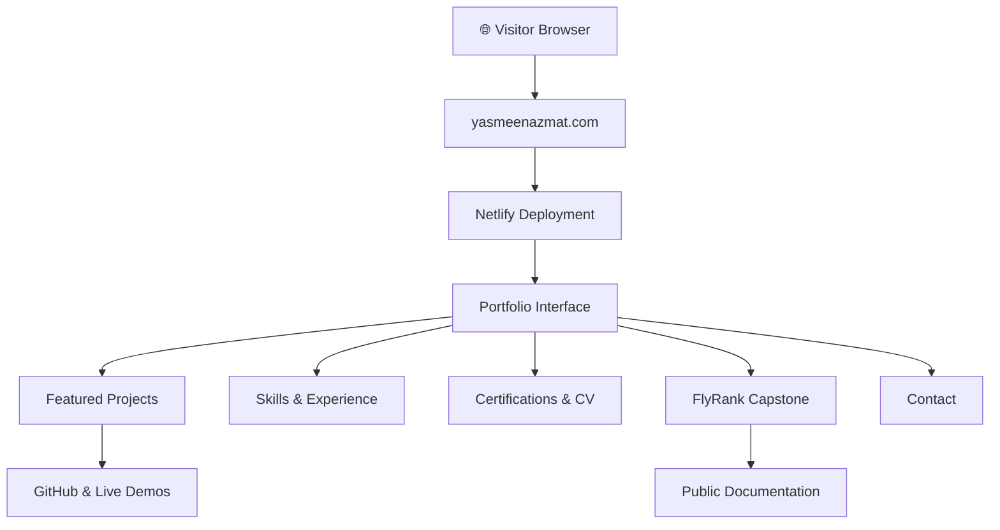

 <div align="center">

# ✦ Yasmeen Azmat Ali

### From Projects to Proof
**AI/ML Engineering Portfolio**

*Applied AI · Machine Learning · Agentic Systems · Full-Stack Engineering*

[](https://yasmeenazmat.com)
[](https://aifluency.flyrank.ai/)


### Building intelligent systems. Showing the engineering behind them.

A professional, evidence-first portfolio bringing together my AI/ML projects, technical decisions, live demonstrations, engineering experience, and professional achievements.

**[Explore Portfolio ↗](https://yasmeenazmat.com)** · **[Featured Projects ↗](https://yasmeenazmat.com/#projects)** · **[Contact ↗](https://yasmeenazmat.com/#contact)**

*FlyRank General AI Fluency · Impact Project approved October 5, 2026*

</div>

---

## ✨ Project Snapshot

| | |
|---|---|
| **Project** | From Projects to Proof — AI/ML Engineering Portfolio |
| **Category** | AI/ML Engineering · Portfolio · Web Development |
| **Purpose** | Make engineering work discoverable, understandable, and verifiable |
| **Audience** | Recruiters · Engineers · Collaborators · Hiring Teams |
| **Tech Stack** | HTML · CSS · JavaScript · Netlify |
| **Deployment** | [yasmeenazmat.com](https://yasmeenazmat.com) |
| **Source Code** | Private implementation |
| **Documentation** | Public |
| **FlyRank Status** | Impact Project Approved |

---

## 🎯 The Story Behind the Project

### The Challenge

AI/ML engineering work often lives across GitHub repositories, demonstrations, academic projects, and professional profiles.

For recruiters and technical reviewers, this makes it difficult to understand what was built, how it works, and what evidence supports it.

### The Solution

I built a single professional portfolio that brings together technical projects, practical demonstrations, skills, experience, certifications, and project documentation.

Rather than relying on technology lists alone, the portfolio emphasizes:

**Problem → What I Did → What Came of It**

### The Outcome

A deployed, responsive portfolio with a consistent project-card design, interactive navigation, animations, technical evidence links, and a dedicated FlyRank Capstone section.

The portfolio makes it easier to explore my engineering work and understand the decisions behind it.

---

## 🧠 Featured Engineering Work

| Project | Focus |
|---|---|
| **Multi-Agent RAG Research Assistant** | Retrieval, research automation, and agent orchestration |
| **InvoiceGuard** | Explainable invoice-risk assessment and human approval |
| **CivicRelay** | Agentic civic-issue management |
| **Clerkly** | Human-in-the-loop paperwork workflows |
| **Real-Time Twitter Sentiment Analysis** | Kafka, Spark, NLP, and streaming machine learning |
| **AI Career Guidance Assistant** | AI-powered career exploration and skills guidance |

**[Explore All Projects ↗](https://yasmeenazmat.com/#projects)**

*Live demonstrations and GitHub repositories are linked where available. Not every project currently has a public deployment.*

---

## ⚡ Portfolio Features

| Feature | Description |
|---|---|
| 🎨 **Responsive Design** | Desktop and mobile-friendly layouts |
| ✨ **Motion & Interaction** | Section reveals, hover effects, and animated elements |
| 🧩 **Featured Projects** | Consistent cards with project context and evidence |
| 🔎 **Project Exploration** | Navigation and available project filters |
| 🏆 **FlyRank Capstone** | Compact approved-project showcase |
| 📄 **Professional Profile** | Skills, experience, certifications, and CV |
| 🔗 **Evidence Links** | GitHub repositories and available demonstrations |
| ✉️ **Contact** | Professional contact options |

---

## 🏗️ System Architecture



### Technology Stack


The architecture illustrates the visitor-facing system. Internal contact processing and deployment configuration are not independently verified in this public documentation.

---

## 🚀 Explore the Portfolio

**No installation or account is required.**

1. Open **[yasmeenazmat.com](https://yasmeenazmat.com)**.
2. Browse the Featured Projects and additional projects.
3. Use the available filters and open supporting evidence links.
4. Review skills, experience, and certifications.
5. Explore the FlyRank Capstone section.
6. Download the CV or use the available contact options.

<details>
<summary><b>💻 Local Development and Reproducibility</b></summary>

The portfolio implementation is private.

Authorized collaborators with the original HTML, CSS, JavaScript, and assets can run the static version locally.

```bash
python3 -m http.server 8000
```

Then open:

```text
http://localhost:8000
```

Check navigation, images, project cards, animations, CV download, and contact behavior.

**Reproducibility limitation:** This documentation repository does not contain the complete source files needed to independently rebuild the website.

</details>

---

## 📊 Performance & Quality

### October 11, 2026 — PageSpeed Insights

| Category | Recorded Result |
|---|---:|
| 🖥️ Desktop Performance | **97/100** |
| 📱 Mobile Performance | **71–72/100** |
| ♿ Accessibility | **100/100** |
| 🛡️ Best Practices | **100/100** |
| 🔍 SEO | **100/100** |
| 🤖 Agentic Browsing | **2/2** |

These results were measured before the latest Capstone redesign. They should not be interpreted as fresh scores for the final version.

**Mobile metrics:** FCP 4.1 s · LCP 4.7 s · TBT 0 ms · CLS 0 · Speed Index 5.1 s.

### Testing Summary

| Area | Recorded Status |
|---|---|
| Desktop layout | User-tested |
| Mobile responsiveness | User-tested |
| Scroll animations | Implemented and user-tested |
| Project-card hover effects | User-tested |
| Capstone redesign | Completed and visually reviewed |
| Navigation and project filters | User-tested; detailed results not recorded |
| Static package inspection | 4/4 categories passed on earlier package |
| Final-version PageSpeed | Retest pending |

<details>
<summary><b>🔬 Detailed Static Verification</b></summary>

**Evidence date:** October 11, 2026

| Check | Result |
|---|---|
| Local asset references | 15/15 resolved |
| Internal section anchors | 16 inspected, 0 unresolved |
| Image alternative text | 10/10 nonempty |
| Main portfolio sections | Present |
| Static inspection categories | 4/4 passed |

These results apply to the inspected earlier package.

</details>

<details>
<summary><b>🧪 Additional Verification Boundaries</b></summary>

The following checks still need documented end-to-end results:

- Individual external-link destinations
- CV download behavior
- Contact-form delivery
- Manual keyboard accessibility
- Final-version mobile and desktop PageSpeed measurements

User-reported functional testing and static checks are not substitutes for these specific tests.

</details>

---

## 🎨 Engineering & Design Decisions

### 01 — Evidence Over Claims

The portfolio prioritizes project context, engineering decisions, and links to supporting work rather than only displaying technology names.

### 02 — Consistency Across Projects

Featured Projects share a consistent card layout so visitors can compare projects without learning a different interface for each one.

### 03 — Compact FlyRank Capstone

The Capstone was redesigned to match the Featured Projects cards.

Unnecessary nested panels, oversized spacing, and separate Challenge/Solution/Outcome boxes were removed while preserving the screenshot, links, and approved status.

### 04 — Motion With Purpose

Subtle animation, hover lighting, and scroll-triggered reveals make the portfolio engaging without replacing meaningful technical content.

### 05 — Public Evidence, Private Implementation

Documentation is public for reviewers, while implementation source files remain private. This improves public discoverability but limits independent source-based reproducibility.

---

## ⚠️ Known Limitations

- The complete implementation is not publicly available.
- Some projects still need additional interactive demonstrations.
- Mobile performance has room for improvement based on the recorded October 11 test.
- Final-version PageSpeed and complete end-to-end verification remain pending.
- Building in Public can be expanded with deeper technical case studies.
- NEXA remains in development and is not presented as completed work.
- An official FlyRank graduate badge will only be displayed after issuance.

---

## 🤝 AI Assistance & Human Verification

AI-assisted tools, including Claude, supported planning, content organization, interface refinement, and development activities.

AI-generated suggestions were not assumed to be correct without review.

I remained responsible for project selection, engineering decisions, content accuracy, integration, testing, and deployment.

The evaluation section separates measured evidence, static verification, user-reported testing, and pending checks.

---

## 🎬 Live Demonstration

**Format:** Narrated portfolio walkthrough  
**Target Duration:** 3–5 minutes  
**Status:** Final recording pending

| Segment | What I'll Demonstrate |
|---|---|
| 0:00–0:35 | Portfolio introduction and purpose |
| 0:35–1:40 | Featured Projects and interactive filters |
| 1:40–2:30 | Project evidence and design decisions |
| 2:30–3:15 | Skills, certifications, CV, and contact |
| 3:15–4:10 | FlyRank Capstone and known limitation |
| 4:10–4:40 | AI assistance, verification, and next steps |

**Demo video:** Link will be added after recording.

---

## 🗺️ Development Roadmap

### Completed

- [x] Build and deploy the portfolio
- [x] Receive FlyRank Impact Project approval
- [x] Implement responsive design and animations
- [x] Redesign the Capstone section
- [x] Conduct desktop and mobile user testing
- [x] Record initial static and performance evaluations
- [x] Publish updated technical documentation

### Next Improvements

- [ ] Re-run PageSpeed on the final deployed website
- [ ] Document remaining functional and accessibility checks
- [ ] Record the narrated FlyRank demonstration
- [ ] Submit documentation and demo to FlyRank
- [ ] Add more technical case studies and live demonstrations
- [ ] Complete and validate NEXA
- [ ] Add the official FlyRank graduate badge when issued

---

<div align="center">

### ✦ Built to show the work, not just describe it.

**AI Engineering · Technical Evidence · Real-World Applications**

[](https://yasmeenazmat.com)

**Yasmeen Azmat Ali**

*FlyRank General AI Fluency Capstone · 2026*

*Public documentation · Private implementation*

</div> 
