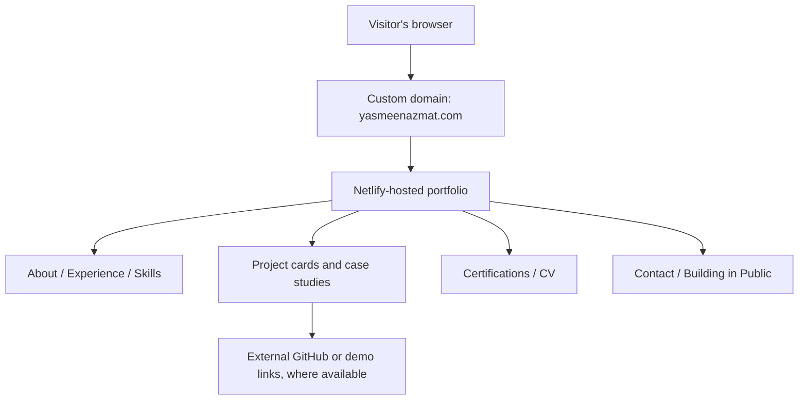

<div align="center">

# ✦ Yasmeen Azmat Ali
### AI/ML Engineering Portfolio

**Applied AI · Machine Learning · Agentic Systems · Full-Stack Development**

[](https://yasmeenazmat.com)
[](https://aifluency.flyrank.ai/)
[](https://yasmeenazmat.com)
[](#privacy-and-reproducibility)

**One destination for the projects, decisions, and evidence behind my AI engineering work.**

[**Explore Portfolio ↗**](https://yasmeenazmat.com) · [**Browse Projects ↗**](https://yasmeenazmat.com/#projects) · [**Contact ↗**](https://yasmeenazmat.com/#contact)

<sub>FlyRank General AI Fluency · Impact Project approved October 5, 2026 · Public documentation / private implementation</sub>

</div>

---

## ✨ At a glance

| | |
|:--|:--|
| **What it is** | A public, evidence-led portfolio of AI/ML engineering work, technical skills, experience, and certifications |
| **Who it's for** | Recruiters, technical reviewers, potential collaborators, and internship or employment teams |
| **Primary goal** | Help a visitor understand what I build, why it matters, and where to inspect the work |
| **Live site** | **[yasmeenazmat.com](https://yasmeenazmat.com)** |
| **Deployment** | Netlify, accessed through a custom domain |
| **Source visibility** | Private; this repository contains **documentation only** |

### Contents

[Overview](#-overview) · [Portfolio experience](#-portfolio-experience) · [Architecture](#-architecture) · [How to use](#-how-to-use) · [Setup](#-setup-and-reproducibility) · [Evaluation](#-v2-evaluation-and-quality-checks) · [Decisions](#-design-decisions) · [Limitations](#-known-limitations) · [AI transparency](#-ai-assistance-and-verification) · [Demo](#-live-demo) · [Roadmap](#-roadmap)

---

## 🎯 Overview

This portfolio brings my **machine learning, agentic AI, research, and software engineering** work into one navigable experience. Rather than asking visitors to rely on a list of technologies, it points them toward project descriptions, implementation context, and supporting GitHub repositories or demonstrations when available.

The FlyRank capstone uses a repeatable case-study pattern:

> **Problem → What I Did → What Came of It**

That structure is intended to make technical decisions, my contribution, and the outcome easier to assess.

## 🧭 Portfolio experience

| Section | What visitors find |
|:--|:--|
| 🏠 **Home / About** | Engineering focus, background, and introduction |
| 🧠 **Projects** | Applied AI/ML and software projects, with available evidence links |
| 🛠️ **Skills** | Technical capabilities and tools |
| 💼 **Experience** | Professional and internship experience |
| 🎓 **Certifications** | Credentials and available verification links |
| ✍️ **Blog / Building in Public** | Space for technical notes, retrospectives, and capstone updates |
| ✉️ **Contact** | Contact interface and ways to connect |
| 📄 **Download CV** | Access to the published CV |

### Selected project areas

- **Multi-agent research and RAG:** research assistance, retrieval, orchestration, and verification workflows.
- **InvoiceGuard:** explainable invoice-risk review with human approval in the loop.
- **CivicRelay and Clerkly:** agent-oriented applications with workflow safeguards.
- **Real-time sentiment analysis:** data streaming and applied machine-learning research.
- **AI career guidance:** skills and career-path exploration.

> These are examples of work represented in the portfolio, **not a claim that every project has a publicly accessible live deployment**. Check each project card for its available links.

---

## 🏗️ Architecture



**Implementation overview**

| Layer | Current understanding |
|:--|:--|
| Frontend | HTML, CSS, and JavaScript files verified in the local portfolio ZIP; deployment build configuration not independently verified |
| Hosting | Netlify |
| Domain | [yasmeenazmat.com](https://yasmeenazmat.com) |
| Project evidence | Links to external project repositories and demos where provided |
| Documentation | This public repository; implementation files remain private |

*The diagram describes the visitor-facing system. It is not a verified internal component map; contact processing and build configuration require checking against the private deployment.*

---

## 🚀 How to use

**No installation or account is required to view the live portfolio.**

1. Visit **[yasmeenazmat.com](https://yasmeenazmat.com)**.
2. Navigate from **Home** to **Projects** to review work and evidence links.
3. Try the project filters, where present, and inspect a project card.
4. Review **Skills**, **Experience**, and **Certifications**.
5. Try **Download CV** and inspect the **Contact** options.
6. Open **Building in Public** to see the current content and planned updates.

### Example reviewer journey

```text
Open yasmeenazmat.com
  → Read the introduction
  → Navigate to Projects
  → Filter or select a project
  → Open its GitHub/demo evidence, if available
  → Review experience and certifications
  → Check CV download and contact options
```

## 💻 Setup and reproducibility

### Public experience — reproducible now

Open the live URL in a modern desktop or mobile browser. No local environment is necessary to evaluate the **deployed experience**.

### Local development — private-source access required

This is **not** a public source-code repository. An authorized collaborator with the original source folder can:

1. Obtain the private project files through an approved channel.
2. Inspect the entry point and build configuration.
3. If the project is plain HTML/CSS/JavaScript without a build step, start a local server from the project root:

   ```bash
   python3 -m http.server 8000
   ```

4. Open `http://localhost:8000` and verify navigation, images, project links, CV download, and contact behavior.
5. If the source instead includes a package/build configuration, follow **its actual scripts** rather than assuming the static-server command is sufficient.

> **Reproducibility disclosure:** A stranger cannot recreate the complete source-based build from this public README alone because the implementation is private. FlyRank reviewers may request an approved private review method to assess this criterion.

---

## 🧪 V2 evaluation and quality checks

**Evidence date:** 11 October 2026. **Method:** Static inspection of the local portfolio package `Yasmeen_Portfolio_COMPACT_VERIFIED.zip` (HTML, JavaScript, CSS, and bundled assets). These checks validate package structure only; they are **not** substitutes for live browser, mobile, accessibility, or end-to-end testing.

| Check | Observed result | Status |
|:--|:--|:--|
| Local HTML asset references | 15 local file references checked; 15 corresponding files exist in the package | **PASS — static** |
| Internal section anchors | 16 in-page anchor references inspected; 0 unresolved targets | **PASS — static** |
| Project images / accessible text | 10 image elements found; all 10 include nonempty `alt` text | **PASS — static** |
| Portfolio section structure | Home, About, Projects, Skills, Experience, Certifications, Capstone, and Contact section IDs found in the HTML | **PASS — static** |
| Desktop navigation interactions | Must click each navigation item in a real browser | **Not yet verified** |
| Mobile layout / horizontal overflow | Must test on an actual phone or responsive browser viewport | **Not yet verified** |
| Project filters | Must interact with filters and confirm displayed cards | **Not yet verified** |
| External GitHub and demo destinations | Must open and confirm every destination | **Not yet verified** |
| CV download | CV file exists in the package; download behavior must be checked in browser | **Partially checked** |
| Contact form | Must submit a controlled test and verify receipt or expected result | **Not yet verified** |
| Keyboard accessibility / focus | Requires manual keyboard testing | **Not yet verified** |
| Mobile performance | Requires a measured mobile test, such as Lighthouse | **Not yet measured** |

**Static evaluation summary:** 4 / 4 static inspection categories passed. This is **not a website-wide pass rate** and no numeric v2 performance or user-experience score has been established. Record browser/device, test date, observed outcomes, and screenshots or video before reporting end-to-end v2 results.

## 🧩 Design decisions

**One portfolio instead of scattered project links.** The portfolio brings project evidence, background, skills, and contact information together so reviewers can form a coherent picture without searching multiple platforms.

**Consistent case-study storytelling.** The **Problem → What I Did → What Came of It** format emphasizes contribution and evidence rather than broad technical claims.

**Documentation separated from source.** Public documentation makes the project easier to review while keeping the implementation private. The trade-off is reduced independent reproducibility.

## ⚠️ Known limitations

- **Private source:** Public documentation alone does not allow a stranger to rebuild the site from scratch.
- **Evaluation partially completed:** Local static package checks passed; browser interactions, cross-device behavior, accessibility, and performance still need dated evidence.
- **Building in Public:** The section currently describes planned notes and updates rather than a complete technical blog.
- **NEXA:** Identified as a future case study; it should not be described as completed until tested and ready.
- **Graduate badge:** An official FlyRank badge should only be displayed once issued, with its verification link.

## 🤝 AI assistance and verification

**AI tools and scope:** I used **Claude** as an AI-assisted development and planning tool to help organize the portfolio, refine written case-study content, and iterate on interface/layout ideas. AI assistance was part of the workflow; it should not be interpreted as proof that AI-generated suggestions were correct or production-ready.

**My responsibility:** I chose the portfolio's purpose, project selection, case-study structure (**Problem → What I Did → What Came of It**), and final presentation. I reviewed and integrated the material into my portfolio, deployed it, and am responsible for the accuracy of claims and for checking user-facing behavior. For this README, I also inspected the local site package and recorded only the static results supported by that inspection.

**Verification boundary:** The local package checks above do not establish that the contact form delivers messages, that external links work today, or that the site is fully accessible or mobile-tested. Those require separate live checks, which remain open. NEXA is still in progress and is not represented as a finished project.

## 🎬 Live demo

**Planned length:** 3–5 minutes · **Format:** live screen recording with narration · **Slides:** none

| Time | Show on screen | Explain |
|:--|:--|:--|
| 0:00–0:35 | Live home page | Purpose and intended audience |
| 0:35–1:40 | Projects and a working filter | One real interaction and the project evidence |
| 1:40–2:30 | Project details and external links | Why evidence-led case studies were chosen |
| 2:30–3:15 | Skills, certifications, CV or contact | Practical visitor journey |
| 3:15–4:10 | Building in Public | Honest limitation and next improvement |
| 4:10–4:40 | Return to home page | AI assistance, human verification, and wrap-up |

**Demo video URL:** *Add the actual public or unlisted video link after recording.*

---

## 🗺️ Roadmap

- [ ] Finish and validate **NEXA** before publishing it as a portfolio case study.
- [ ] Publish technical notes and project retrospectives.
- [x] Record local static package inspection results (11 October 2026).
- [ ] Record and link dated browser-functional, accessibility, and mobile test evidence.
- [ ] Add the official FlyRank graduate badge and verification link when issued.
- [ ] Attach the 3–5 minute live demo to this README and the FlyRank showcase submission.

---

<div align="center">

### Built to show the work, not just describe it.

**[Visit yasmeenazmat.com ↗](https://yasmeenazmat.com)**

<sub>FlyRank General AI Fluency capstone documentation · © 2026 Yasmeen Azmat Ali · Source code remains private</sub>

</div>
