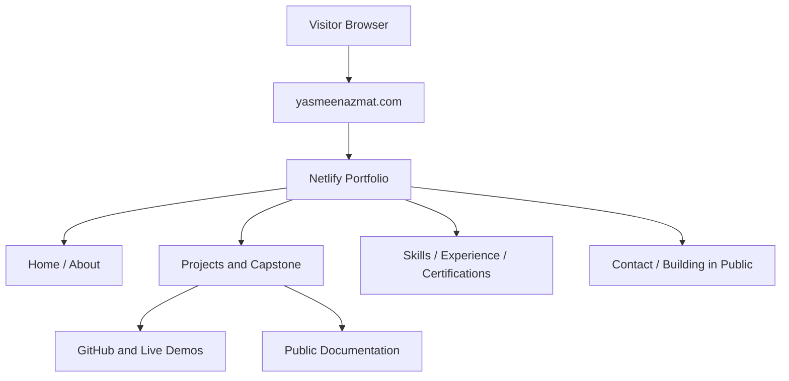

# ✦ Yasmeen Azmat Ali
### AI/ML Engineering Portfolio

**Applied AI · Machine Learning · Agentic Systems · Full-Stack Development**

[🌐 Live Portfolio](https://yasmeenazmat.com) · [FlyRank General AI Fluency](https://aifluency.flyrank.ai/) · **Impact Project Approved**

**One destination for the projects, decisions, and evidence behind my AI engineering work.**

FlyRank General AI Fluency · Impact Project approved October 5, 2026 · Public documentation / private implementation

---

## ✨ At a Glance

| | |
|---|---|
| **Project** | From Projects to Proof — AI/ML Engineering Portfolio |
| **Purpose** | Showcase AI/ML projects, technical evidence, live demonstrations, skills, and professional experience |
| **Audience** | Recruiters, technical reviewers, collaborators, and hiring teams |
| **Live website** | [yasmeenazmat.com](https://yasmeenazmat.com) |
| **Hosting** | Netlify with a custom domain |
| **Source visibility** | Private implementation; public documentation |
| **FlyRank status** | Impact Project Approved — October 5, 2026 |
| **Development status** | Portfolio redesign complete; final narrated demo pending |

## 🎯 Overview

**From Projects to Proof — AI/ML Engineering Portfolio** is a professional website that brings together my work in machine learning, agentic AI, research, backend development, and full-stack engineering.

The goal is to make my technical work easier to discover, understand, and evaluate through project descriptions, GitHub repositories, available live demos, engineering decisions, and professional experience.

The FlyRank capstone follows a consistent storytelling framework:

**Problem → What I Did → What Came of It**

This approach helps visitors understand the motivation, technical contribution, and outcome behind each project.

## 🧭 Portfolio Experience

| Section | Purpose |
|---|---|
| Home / About | Introduction, engineering focus, and background |
| Featured Projects | Selected technical work and supporting evidence |
| More Projects | Additional software and AI projects |
| Skills | Technologies, frameworks, and engineering capabilities |
| Experience | Professional and internship experience |
| Certifications | Completed credentials and available verification |
| FlyRank Capstone | Portfolio project, approval status, and documentation |
| Building in Public | Technical updates and planned retrospectives |
| Contact | Professional contact options |
| Download CV | Access to the published résumé |

### Selected Project Areas

- Multi-agent research and retrieval-augmented generation
- InvoiceGuard — explainable invoice-risk analysis with human approval
- CivicRelay and Clerkly — agentic workflow applications
- Real-time Twitter sentiment analysis using Kafka, Spark, and machine learning
- AI Career Guidance Assistant
- Additional applied AI, backend, and software engineering projects

Not every project has a publicly accessible live deployment. Individual project cards identify the evidence and links available.

## 🏗️ Architecture



### Technology and Implementation

| Component | Technology |
|---|---|
| Frontend | HTML, CSS, JavaScript |
| Styling | Responsive CSS, transitions, and animations |
| Interactivity | JavaScript-based navigation and project interactions |
| Hosting | Netlify |
| Domain | yasmeenazmat.com |
| Documentation | Public README |
| Implementation source | Private |

The diagram represents the visitor-facing architecture. Contact processing and deployment configuration are not independently documented here.

## 🚀 How to Use

No account or installation is required.

1. Visit [yasmeenazmat.com](https://yasmeenazmat.com).
2. Explore the introduction and professional background.
3. Navigate to Featured Projects and browse the project cards.
4. Use the available project filters.
5. Open GitHub repositories or live demonstrations where available.
6. Review technical skills, experience, and certifications.
7. Explore the FlyRank Capstone section.
8. Download the CV or use the available contact options.

## 💻 Setup and Reproducibility

### Public Website

The deployed portfolio can be reviewed directly through a modern desktop or mobile browser.

### Local Development

The source code is private. Authorized collaborators with access to the original files can start a local server from the portfolio directory:

```bash
python3 -m http.server 8000
```

Then open:

```text
http://localhost:8000
```

The local static-server workflow is applicable to the HTML/CSS/JavaScript version of the portfolio. If a different build configuration is introduced, follow the corresponding project scripts.

**Reproducibility limitation:** The public README allows reviewers to evaluate the deployed experience, but it does not provide the complete private implementation needed to rebuild the site independently.

## 🧪 Evaluation and Quality Checks

### 1. Static Package Verification

**Evidence date:** October 11, 2026  
**Method:** Inspection of the earlier local portfolio package.

| Check | Recorded result |
|---|---|
| Local asset references | 15/15 resolved |
| Internal section anchors | 16 inspected; 0 unresolved |
| Image alternative text | 10/10 images had nonempty alt text |
| Main portfolio sections | Present |
| Static inspection categories | 4/4 passed |

These results apply to the inspected package, not automatically to every later revision.

### 2. PageSpeed Insights Evaluation

**Evidence date:** October 11, 2026  
**Tested version:** Portfolio before the latest Capstone redesign.

| Metric | Recorded result |
|---|---|
| Desktop Performance | **97/100** |
| Mobile Performance | **71–72/100** |
| Accessibility | **100/100** |
| Best Practices | **100/100** |
| SEO | **100/100** |
| Agentic Browsing | **2/2** |

Additional recorded mobile metrics:

- First Contentful Paint: 4.1 seconds
- Largest Contentful Paint: 4.7 seconds
- Total Blocking Time: 0 ms
- Cumulative Layout Shift: 0
- Speed Index: 5.1 seconds

The mobile results indicate that performance optimization remains a potential improvement area.

**Important:** These are historical measured results. A fresh PageSpeed evaluation is required to establish scores for the final redesigned version.

### 3. Functional and Visual Testing

**Latest testing period:** October 2026

The redesigned portfolio was run locally, visually reviewed through screen recordings, and subsequently tested by the project owner on desktop and mobile.

| Area | Status |
|---|---|
| Desktop layout | User-tested |
| Mobile responsive layout | User-tested |
| Hero presentation | Visually reviewed |
| Scroll and reveal animations | Implemented and user-tested |
| Featured Projects layout | Visually reviewed |
| Capstone card redesign | Completed and visually reviewed |
| Project-card hover effects | User-tested |
| Navigation and project filters | User-tested; detailed results not recorded |
| External links | Individual destination verification not documented |
| CV download | File presence checked; download result not documented |
| Contact-form delivery | End-to-end delivery not documented |
| Keyboard accessibility | Manual audit not documented |
| Final-version PageSpeed | Retest pending |

These status descriptions distinguish user-reported testing from independently recorded measurements.

## 🧩 Design Decisions

### Evidence-First Portfolio

Instead of relying only on a list of technologies, the portfolio provides project context and direct access to supporting work.

### Consistent Project Presentation

Featured Projects use a shared card design, making the portfolio easier to scan and navigate.

### Compact FlyRank Capstone

The Capstone section was redesigned to match the Featured Projects card layout.

This removed oversized nested containers and separate Challenge, Solution, and Outcome panels while preserving the project description, screenshot, live website, documentation, and approval status.

### Motion and Interaction

Subtle animations, section reveals, and hover effects were introduced to make the interface engaging without changing the underlying content or navigation.

### Private Source, Public Documentation

The implementation remains private, while public documentation explains the purpose, architecture, usage, decisions, limitations, and evaluation evidence.

## ⚠️ Known Limitations

- The private source prevents complete independent source-based reproducibility.
- Some projects do not yet have publicly accessible live demonstrations.
- The Building in Public section can be expanded with more technical case studies.
- Mobile performance has room for improvement based on the October 11 measurement.
- Final-version performance and complete end-to-end functional results have not yet been documented.
- NEXA remains in development and should not be presented as a completed project.
- An official FlyRank graduate badge will only be added after it is issued.

## 🤝 AI Assistance and Verification

AI-assisted tools, including Claude, were used to support portfolio planning, content organization, interface iteration, and development activities.

AI assistance helped accelerate the workflow, but generated suggestions were not treated as automatically correct.

I remained responsible for project selection, technical content, portfolio decisions, integration, testing, deployment, and the accuracy of the published material.

The final documentation distinguishes recorded results, user-reported checks, and items still awaiting independent verification.

## 🎬 Live Demo

**Planned duration:** 3–5 minutes  
**Format:** Live portfolio walkthrough with narration  
**Status:** Pending final recording

| Time | Demonstration |
|---|---|
| 0:00–0:35 | Introduce the portfolio and its purpose |
| 0:35–1:40 | Explore Featured Projects and filters |
| 1:40–2:30 | Demonstrate project evidence and explain a design decision |
| 2:30–3:15 | Show skills, certifications, CV, and contact options |
| 3:15–4:10 | Explain the FlyRank Capstone and a known limitation |
| 4:10–4:40 | Discuss AI assistance, verification, and next steps |

**Demo video:** To be added after recording.

## 🗺️ Roadmap

- [x] Build and deploy the professional AI/ML portfolio.
- [x] Receive FlyRank Impact Project approval.
- [x] Redesign the Capstone to match Featured Projects.
- [x] Implement portfolio animations.
- [x] Perform desktop and mobile user testing.
- [x] Document the October 11 static and performance evaluation.
- [x] Update public documentation.
- [ ] Re-run PageSpeed on the final deployed version.
- [ ] Document remaining end-to-end functional checks.
- [ ] Record and publish the 3–5-minute narrated demo.
- [ ] Submit final documentation and video to FlyRank.
- [ ] Publish additional technical case studies.
- [ ] Complete and validate NEXA before featuring it as finished work.
- [ ] Add the official FlyRank graduate badge when issued.

---

### Built to show the work, not just describe it.

**[Visit My Portfolio ↗](https://yasmeenazmat.com)**

FlyRank General AI Fluency Capstone · © 2026 Yasmeen Azmat Ali  
Public documentation · Private implementation
